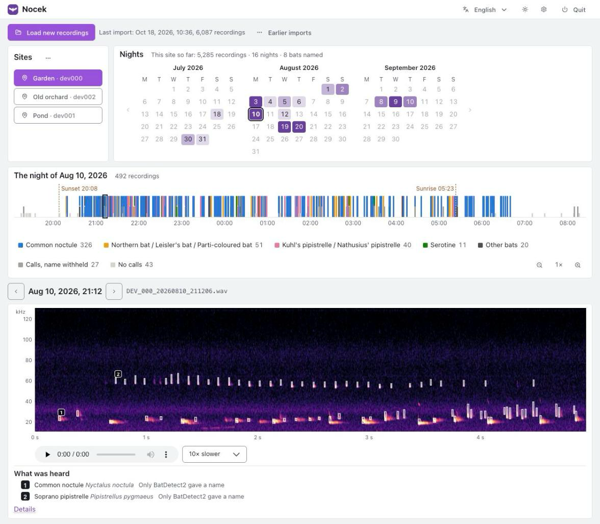

# Nocek

Identify bats from ultrasonic recordings, in your browser.

<picture>
  <source media="(prefers-color-scheme: dark)" srcset="docs/screenshot-dark.png">
  
</picture>

Bring in the recordings from your recorder's card, and Nocek copies the new
ones, finds the echolocation calls, names the bats and shows you what has been
flying past, night by night. It runs on your own computer and your recordings
never leave it.

> **Status:** an early version, in use by its authors. Expect rough edges, and
> please report them.

## What you need

- A computer with one of:
  - macOS 12 or newer on Apple Silicon (M1 or later)
  - Windows 10 or 11, 64-bit
  - Linux, x86-64 or ARM64
- About 1.5 GB of disk space for Nocek itself, most of it PyTorch, and room for
  your recordings.
- A pippyg recorder. It is the only recorder Nocek reads for now.
- An internet connection to install Nocek, and once more on its first start, to
  download one of its models (about 52 MB).

## Install

Nocek is installed with [uv](https://docs.astral.sh/uv/), which also brings the
version of Python Nocek needs, so you do not need Python installed already.

1. Install uv. On macOS or Linux, in a terminal:

   ```
   curl -LsSf https://astral.sh/uv/install.sh | sh
   ```

   On Windows, in PowerShell:

   ```
   powershell -ExecutionPolicy ByPass -c "irm https://astral.sh/uv/install.ps1 | iex"
   ```

   Then open a new terminal, so that it finds `uv`.

2. Install Nocek:

   ```
   uv tool install --python 3.13 --torch-backend auto git+https://github.com/kazek/nocek
   ```

   `--torch-backend auto` picks the build of PyTorch that suits your computer:
   with an NVIDIA graphics card, one that uses it; without one, the much smaller
   build for the processor alone. uv still calls the option experimental; should
   it ever fail, leave it out.

3. Put Nocek in your system's menu, so you can start it without a terminal:

   ```
   nocek shortcut
   ```

   On macOS this adds Nocek to Applications (and so to Launchpad and
   Spotlight), on Windows to the Start menu, on Linux to the applications menu.
   If the terminal does not find `nocek`, run `uv tool update-shell` and open a
   new terminal.

## First start

Start Nocek from its shortcut, or with `nocek` in a terminal. It opens in your
browser at `http://127.0.0.1:6475`. Starting it again while it runs just opens
the page once more.

The first time, it asks for two things:

- **A library**: one folder where Nocek keeps the recordings it copies and what
  it found in them. It offers `Documents/Nocek`. A library can be backed up or
  moved as a whole, as one folder.
- **The models**: one of the three ways Nocek tells bats apart needs about 52 MB
  of files, downloaded once.

To stop Nocek, use **Quit** in the page's top right corner.

## Using Nocek

**Load new recordings.** Choose the folder with the recorder's files: the
memory card, a copy of it, or one of its `bats_dev000`-style folders; the
folders inside are searched too. Nothing on the card is changed, and recordings
already in the library are skipped, so the same card can be loaded again
safely. Recordings made in the recorder's bird mode are left out.

**Sites.** A pippyg can be set to a number, which also names its files
(`DEV_000_…`). Nocek takes each number to stand for a place, a site. The first
time a number turns up, Nocek asks which site it stands for and suggests a new
one named after it, such as `dev000`, placed where the recorder's GPS put it;
after that, its recordings go there by themselves. In the **⋯** menu by the
sites you can rename sites, move a number to another site, and say which bats
are expected at each.

**Nights.** The calendar shades each night by how many of its recordings named a
bat. Pick a night to see it.

**The night.** One bar from sunset to sunrise, with a mark for every recording:
coloured by the bat, as tall as what it holds (a named bat, calls with the name
withheld, or no calls). Point at a mark to see what it is, click it to open it.
The legend counts each kind; point at an entry, or click it, to pick out its
marks. On a busy night, zoom in with the magnifiers (or Ctrl and the scroll
wheel, or a pinch on a trackpad) and drag the bar sideways.

**The recording.** Its spectrogram, with each animal's calls boxed and
numbered; drag across it to look closer. Playback is slowed (10 times by
default) so that the calls fall where you can hear them. Under it, what was
heard; **Details** shows how each method saw it. The arrow keys step through the
night, the space bar plays and pauses.

**How a bat gets its name.** [BatDetect2](https://github.com/macaodha/batdetect2)
names the animals in a recording. Two other methods check it: a field key that
measures the calls, and [BattyBirdNET](https://github.com/rdz-oss/BattyBirdNET-Analyzer).
When both of them agree on something else, the name is withheld. So are names
of bats not expected at the site, while bats marked rare need strong evidence.
Bats that cannot be told apart by their calls are named as a group, such as
*Pipistrellus kuhlii / P. nathusii*.

The language, the light or dark theme, and the settings are in the top right
corner. Nocek speaks English, Polish and German.

## Update

```
uv tool upgrade nocek
```

Your library and settings are kept.

## Uninstall

```
nocek shortcut --remove
uv tool uninstall nocek
```

This leaves your library, and the files below, in place; delete them yourself if
you want them gone.

## Where Nocek keeps its files

| | macOS | Windows | Linux |
| --- | --- | --- | --- |
| Library | `~/Documents/Nocek`, unless you chose another folder | `Documents\Nocek`, unless you chose another folder | `~/Documents/Nocek`, unless you chose another folder |
| Settings | `~/Library/Application Support/Nocek` | `%LOCALAPPDATA%\Nocek` | `~/.config/Nocek` |
| Models | `~/Library/Application Support/Nocek/models` | `%LOCALAPPDATA%\Nocek\models` | `~/.local/share/Nocek/models` |
| Log | `~/Library/Logs/Nocek/nocek.log` | `%LOCALAPPDATA%\Nocek\Logs\nocek.log` | `~/.local/state/Nocek/log/nocek.log` |

The log is the file to send along when reporting a problem.

## Privacy

Nocek works on your computer only. It goes online for one thing: to download
BattyBirdNET's model files, once. Your recordings, and what Nocek finds in
them, stay where you put them.

## Licence

Nocek may be used for non-commercial purposes only, under the
[PolyForm Noncommercial License 1.0.0](LICENSE): by individuals, for research,
teaching and conservation, and by charities and public bodies. For any other
use, please ask.

Nocek uses the work of others, under their own licences:

- [BatDetect2](https://github.com/macaodha/batdetect2), Mac Aodha, O. et al.
  (2022): CC BY-NC 4.0, non-commercial.
- [BattyBirdNET](https://github.com/rdz-oss/BattyBirdNET-Analyzer), Zinck, R.D.
  (2023), built on BirdNET by Kahl, S. et al.: CC BY-NC-SA 4.0,
  non-commercial. Downloaded by Nocek, not part of it.
- [Web Awesome](https://webawesome.com): MIT. Included in
  `src/nocek/web/static/vendor/webawesome`.
- [Lucide](https://lucide.dev) icons: ISC. Included in
  `src/nocek/web/static/vendor/lucide`.

## Development

Requires Python 3.11 or newer.

```
git clone https://github.com/kazek/nocek
cd nocek
python3 -m venv .venv
.venv/bin/pip install -e ".[dev]"

.venv/bin/pytest
.venv/bin/ruff check .
.venv/bin/ruff format --check .
.venv/bin/mypy
```

On Windows, use `.venv\Scripts\` instead of `.venv/bin/`. The interface is plain
JavaScript modules with no build step: change a file under
`src/nocek/web/static` and reload the page. See
[docs/roadmap.md](docs/roadmap.md) for how Nocek came about.
